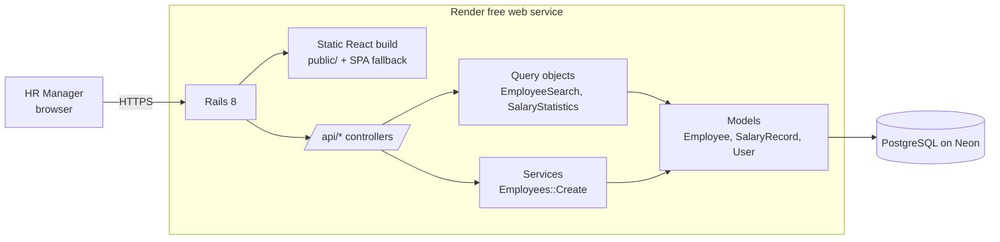
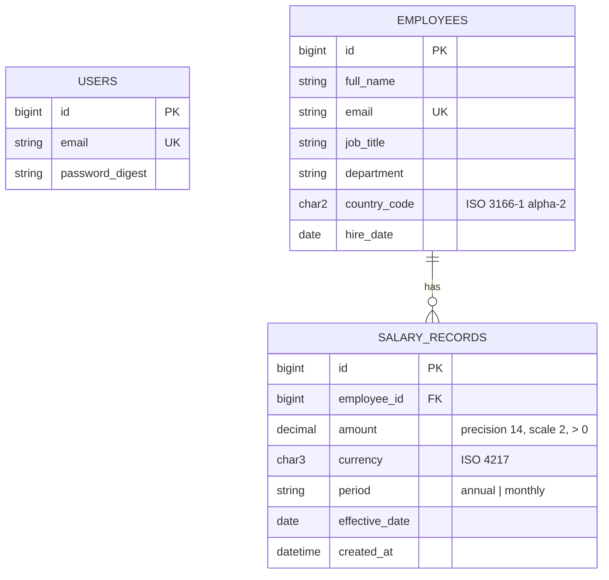

# Salary Management — Design (v1)

Builds on [`requirements.md`](requirements.md). This document covers architecture, data model,
API, the key domain decisions and their trade-offs, the testing strategy and performance.

## 1. Architecture

One Rails application serves both the JSON API and the compiled React app. That means one
deploy, one origin, and session-cookie auth without CORS or tokens.



**Layering rules**
- **Controllers** are thin: auth, params, status codes, JSON rendering. No business logic.
- **Models** own validations and the domain rules (for example `SalaryRecord#annual_amount` and
  `SalaryRecord.current_as_of(date)`).
- **Query objects** (`app/queries`) own read-side SQL: directory search and statistics.
  Each is a plain Ruby object that is easy to unit test.
- **Services** (`app/services`) own multi-step writes, for example creating an employee and
  their first salary in one transaction.

**Stack**

| Layer | Choice |
|-------|--------|
| Backend | Ruby 3.2, Rails 8, PostgreSQL 17 |
| Frontend | React + TypeScript (Vite), React Router, TanStack Query, TanStack Table |
| UI | shadcn/ui + Tailwind, shadcn charts (Recharts), react-hook-form + zod |
| Tests | RSpec + FactoryBot (backend), Vitest + Testing Library (frontend) |
| Hosting | Render (Docker web service) + Neon (Postgres) |

Repository layout:

```
app/            Rails (models, controllers/api, queries, services)
frontend/       Vite React app; `npm run build` outputs into public/
db/seeds/       deterministic seed generator
docs/           requirements, design, AI workflow log
spec/           RSpec
```

## 2. Data model



**Constraints are enforced in the database as well as in the models:** `NOT NULL`, unique email,
`CHECK (amount > 0)`, `CHECK (period IN ('annual','monthly'))`, and a foreign key with
`ON DELETE CASCADE`.

**Indexes**

| Index | Serves |
|-------|--------|
| `salary_records (employee_id, effective_date DESC, id DESC)` | Finding the current salary per employee (the hottest query) |
| `employees (country_code)`, `(department)`, `(job_title)` | Directory filters and insight grouping |
| `employees (email)` unique, `users (email)` unique | Lookups and integrity |

**Reference data:** the supported countries, each with its default currency (for example
IN → INR, US → USD, GB → GBP, DE → EUR), live in one Ruby constant. The UI uses it to
pre-fill the currency, but the currency is still stored on every salary record.

## 3. Key decision: how "current salary" is resolved

**Rule** (from the requirements): the record with the latest `effective_date <= as_of`. On a
tie, the highest `id` wins. `id` is a monotonically increasing sequence, so it gives a reliable
"created last" order, whereas two `created_at` values can be identical.

**Implementation:** one SQL scope, computed at read time.

```sql
SELECT DISTINCT ON (employee_id) *
FROM salary_records
WHERE effective_date <= :as_of
ORDER BY employee_id, effective_date DESC, id DESC
```

`as_of` is always passed in (default `Date.current`). It is never `CURRENT_DATE` inside SQL,
so tests can pin the date and stay deterministic.

**Trade-off considered**

| Option | Pros | Cons |
|--------|------|------|
| **A. Compute at read time (chosen)** | Single source of truth; future-dated raises become current automatically at midnight; nothing can drift | Every read runs a `DISTINCT ON` |
| B. Cache `current_salary_record_id` on `employees` | Simple joins, fast reads | A future-dated record needs a scheduled job to flip the pointer; two sources of truth that can disagree |

At 10,000 employees and ~30,000 records, option A completes in a few milliseconds using the
composite index. Option B's job and consistency problems are a real cost for no measurable
gain. If the data grew 100×, the next step would be a materialized view refreshed daily
rather than a pointer column.

**Append-only history:** there are no update or delete endpoints for salary records, and
`SalaryRecord#readonly?` returns true once a record is persisted. A correction is recorded as a
new record. The only way a record is removed is the cascade when its employee is deleted.

## 4. Salary statistics

`SalaryStatistics.new(group_by:, as_of:, filters:)` returns one row per group, with one
group per **(group key, currency)** so currencies are never mixed.

- `group_by`: `country`, `department`, or `job_title`. Filters such as `country: "IN"` cover
  "salary for job title X within country Y".
- Metrics: headcount, min, max, average, median (`percentile_cont(0.5)`), and total annual payroll.
- Monthly salaries are converted to annual: `CASE period WHEN 'monthly' THEN amount * 12 ELSE amount END`.
- The whole computation is one aggregate SQL query over the current-salary set. Nothing is
  aggregated in Ruby.

The median is included because salary distributions are skewed, and the average alone misleads.

## 5. API

All endpoints are under `/api`, use JSON, and require a session except `POST /api/session`.

| Method & path | Purpose |
|---------------|---------|
| `POST /api/session` | Log in (`email`, `password`). Rate-limited. |
| `GET /api/session` | Current user and CSRF token |
| `DELETE /api/session` | Log out |
| `GET /api/employees` | Directory: `q`, `country`, `department`, `job_title`, `sort`, `page`, `per_page` (max 100). Returns `{ data, meta: { page, per_page, total } }` with current salary. |
| `POST /api/employees` | Create an employee and their initial salary record (one transaction) |
| `GET /api/employees/:id` | Profile, current salary and full salary history |
| `PATCH /api/employees/:id` | Update profile fields (salary changes go through salary records) |
| `DELETE /api/employees/:id` | Delete the employee and their history |
| `POST /api/employees/:id/salary_records` | Record a salary change |
| `GET /api/insights/salaries` | `group_by`, optional filters. Returns statistics rows. |
| `GET /api/filters` | Distinct countries, departments and job titles for dropdowns |

**Errors:** `401` when not logged in, `404` when not found, and
`422 { errors: { field: ["message"] } }` for validation errors. The frontend maps these
straight onto form fields.

**Auth details:** `has_secure_password` (bcrypt), a Rails session cookie
(`HttpOnly`, `Secure`, `SameSite=Lax`), and standard Rails CSRF protection with the token
sent in the `X-CSRF-Token` header. The single HR user is created from the `HR_EMAIL` and
`HR_PASSWORD` environment variables, and there is no sign-up.

## 6. Frontend

| Route | Page |
|-------|------|
| `/login` | Login form |
| `/employees` | Directory: search, filters, sortable paginated table (server-side), with URL query params for sharable state |
| `/employees/new`, `/employees/:id/edit` | Employee form (the new-employee form includes the initial salary) |
| `/employees/:id` | Profile, current salary, salary history timeline, "Record salary change" dialog |
| `/insights` | Group-by selector, country filter, statistics table and bar chart |

- All money is shown with `Intl.NumberFormat` and an explicit currency code, for example
  `INR 12,00,000 / yr`.
- Server state goes through TanStack Query, which handles caching, loading and error states. There is no global store.

## 7. Seeding

`db/seeds` uses a deterministic generator (`Faker` with a fixed `Random.new(42)` seed):
- 10,000 employees spread across around 8 countries and 6 departments, with job titles that
  match each department.
- Salaries come from per-country, per-title bands, so the statistics look plausible. Each
  employee has 1–4 salary records: hire salary, then raises, with some future-dated raises
  and some monthly-period records.
- Rows are written in bulk with `insert_all` in batches of 1,000, aiming to finish in under
  10 seconds rather than taking minutes with one `create!` per row.
- The script is idempotent: it refuses to run if employees already exist, unless
  `RESET=1` is set.

## 8. Testing strategy

| Level | What | Examples |
|-------|------|----------|
| Model unit | Domain rules | Current-salary resolution (latest past date, same-date tie, future-dated ignored, none yet); annual conversion; validations; history is read-only |
| Query unit | SQL correctness | `SalaryStatistics` against a small hand-built dataset with known min, max, avg and median; currencies never mixed; filters and search |
| Service unit | Write workflows | `Employees::Create` rolls back the employee if the salary is invalid |
| Request | API contract | Auth required; status codes; payload shape; validation error format |
| Seed | Generator | Deterministic output for a fixed seed; generates the requested count (run with a small count) |
| Frontend | Key UI logic | Money formatting; form validation; table renders API data |

Tests use FactoryBot, a fixed `as_of` date (never the real clock), and transactional
fixtures, so they are fast and deterministic. A full browser end-to-end suite is out of
scope for v1. A single smoke test may be added if time allows.

## 9. Performance considerations

- **Directory:** filtering, sorting and pagination run in the database (offset pagination,
  `per_page` capped at 100). At 10,000 rows, offset pagination is fine. Keyset pagination
  is the upgrade path at larger scale.
- **Search:** `ILIKE` on name and email. A sequential scan of 10,000 rows takes
  milliseconds. A `pg_trgm` index is the upgrade path.
- **Current salary:** `DISTINCT ON` with the composite index (see §3). The directory joins it
  as a subquery for the page being shown.
- **Measured (10,000 employees, 23,753 salary records, local Postgres 17):** seeding takes 2.9 s.
  Resolving the current salary for *every* employee takes 7.4 ms. For that whole-table query the
  planner picks a sequential scan plus an in-memory sort over the composite index, which is the
  right plan when reading all rows. The index serves per-employee and per-page lookups.
- **Directory, measured on the 10k seed** (fixed three queries per page): default page 2 ms,
  text search 22 ms, country + department filter sorted by annual salary 12 ms, last page of
  100 rows 20 ms, employee detail with history 5 ms.
- **Insights:** a single aggregate query per request. Measured on the 10k seed (median of
  10 runs): by country 15 ms, by department 17 ms, by job title within India 11 ms. Response time and query plans are
  checked against the 10,000-employee seed and recorded here.
- **N+1 queries:** avoided through explicit joins and preloading, and checked in request specs.

## 10. Deployment

- A Dockerfile (Rails 8 default) builds the frontend (`npm ci && npm run build`) and then the
  Rails image.
- Render free web service with `DATABASE_URL` pointing to Neon. Migrations run on deploy and
  the seed runs once.
- **Known limitation:** Render's free tier sleeps after about 15 minutes idle, so the first
  request takes 30–60 seconds. This will be noted in the README and handled before recording
  the demo.
